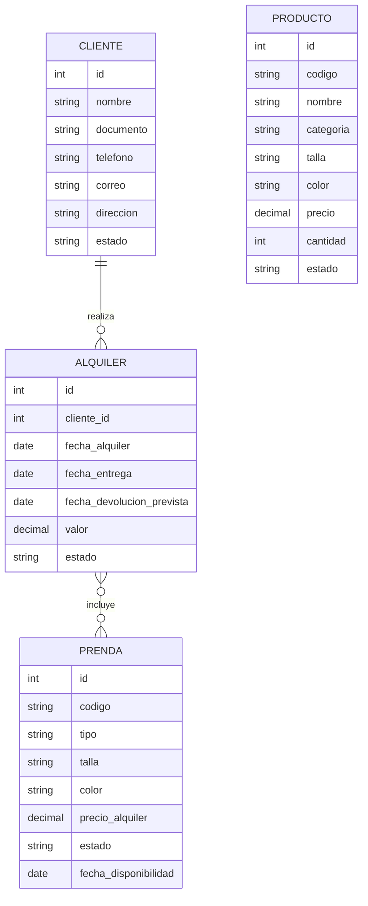

# Plan de implementación

> Plan mínimo y práctico para la prueba técnica. Perfil jr: sin sobre-ingeniería.
>
> **Recorte aprobado (v2):** entrega básica creíble para un plazo muy corto:
> sin responsividad extra (solo clases Bootstrap CDN), sin JS propio, sin DetailViews,
> sin `DetalleAlquiler` (M2M directo), sin vistas de inventario separadas (solo
> filtros por querystring en los listados), un solo seeder, admin con
> `register()` simple, sin campos de imagen (y por tanto sin Pillow).

## Estructura del proyecto

```
comercio/                  (raíz, workspace)
├── .dev/                  (contexto: specs, planes, bitácora, decisiones)
├── .gitignore
├── README.md
├── requirements.txt
├── manage.py
├── comercio/              (proyecto Django: settings, urls)
└── gestion/               (app única con todos los módulos)
    ├── models.py          (Producto, Prenda, Cliente, Alquiler)
    ├── forms.py
    ├── views.py
    ├── urls.py
    ├── admin.py           (register simple, sin customización)
    ├── management/commands/seed.py   (seeder único)
    ├── migrations/
    └── templates/gestion/ (base.html + CRUDs, Bootstrap 5 CDN)
```

Una sola app `gestion` — es lo más simple y suficiente para una prueba jr. **(Aprobado por el usuario — 2026-09-27)**

## Pasos

1. **Scaffold**: proyecto `comercio` + app `gestion`, `requirements.txt` (solo django), `.gitignore`, settings con SQLite y config PostgreSQL comentada, idioma `es`, **una sola migración**.
2. **Modelos** (español, `TextChoices` para estados): Producto, Prenda, Cliente, Alquiler (con `prendas = ManyToManyField(Prenda)`). Sin campos de imagen.
3. **Migraciones** + `admin.py` con `admin.site.register()` simple.
4. **CRUD básico** con vistas genéricas (`ListView`, `CreateView`, `UpdateView`, `DeleteView`) y `ModelForm` para: productos, prendas, clientes. Sin `DetailView`.
5. **Alquileres**: crear/listar/cambiar estado. Validación de **solapamiento de fechas** por prenda (en el form, queryset del ORM, mensaje de error claro).
6. **Plantillas**: `base.html` con navbar Bootstrap 5 (CDN) + plantillas de CRUD. Sin JS propio ni responsividad extra.
7. **Consultas**: los listados aceptan `?estado=...` por querystring (enlaces simples en el navbar). Sin vistas separadas de inventario.
8. **Datos de prueba**: un único comando `python manage.py seed` con pocas filas de ejemplo.
9. **README.md** en español: instalación, venv, dependencias, migraciones, datos de prueba, superusuario, ejecutar servidor.
10. **Bitácora**: registrar la iteración de implementación en `.dev/bitacora.md`.

## Validación de solapamiento (regla clave)

Para cada prenda del alquiler nuevo, buscar alquileres con estado `activo` donde:

```
fecha_entrega <= fecha_devolucion_prevista_nueva
AND fecha_devolucion_prevista >= fecha_entrega_nueva
```

Si existe → error en el formulario indicando la prenda y el alquiler en conflicto.

## Modelo relacional (simplificado)


